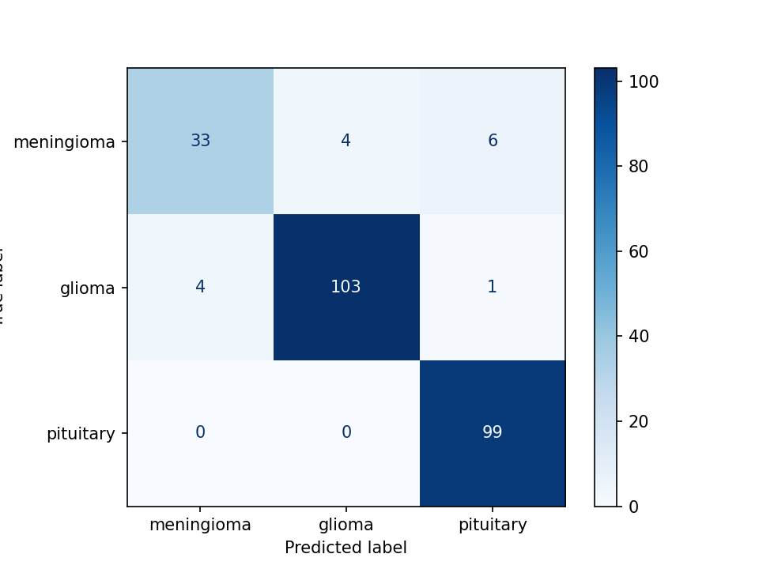
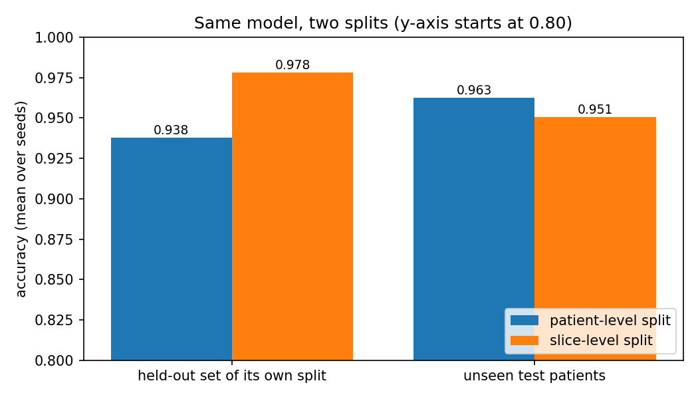
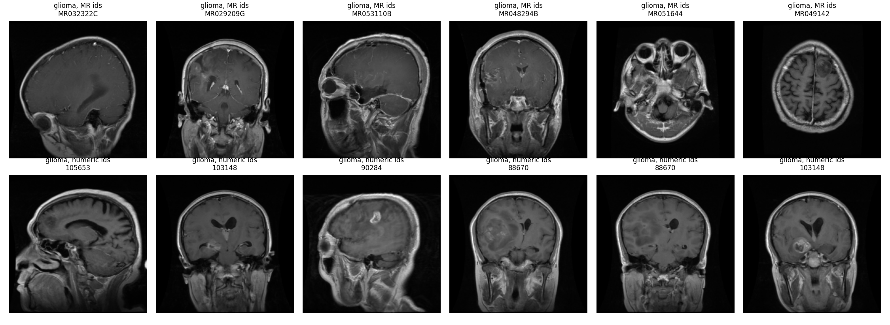
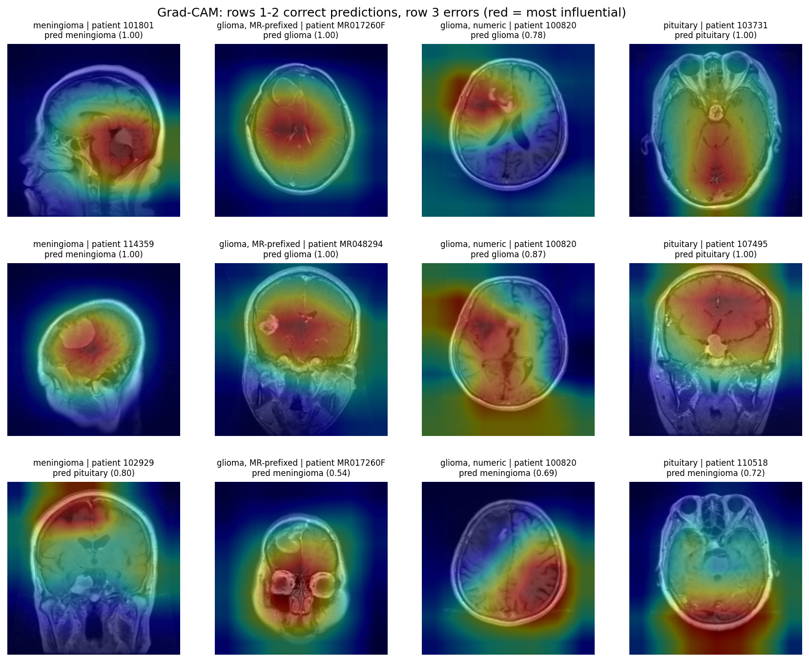

# Brain Tumor MRI Classifier

Classifies 2D brain MRI slices as **meningioma, glioma, or pituitary tumor** with a pretrained ResNet-18, evaluated with a **patient-level split** so the scores aren't inflated by leakage.

**[Live demo](https://huggingface.co/spaces/bloodclaude/brain-tumor-classifier)** (runs in your browser, nothing is uploaded)

> **Research demo, not for medical use.** The model has only been tested on one public dataset.

## Why A Classifier?
My project answers the question "What kind is it?" rather than "Is it there?" or "Where is it?"

1. **A Tumor Detector** looks at an image to determine whether a tumor is present or not. It can also identify the tumor's exact location by drawing a box or outline around it.

2. **A Tumor Classifier** looks at an image and predicts which type of brain tumor it contains. Since my model does not have a "no tumor" category, it assumes that a tumor is already present in the image.

## Why Did I Start?

My interest in machine learning began during a brain tumor classification project with the Society of Asian Scientists and Engineers (SASE). As a Biomedical Engineering student, I helped source MRI datasets and explain clinical imaging concepts to my Computer Science teammates. That experience sparked a question: How do you actually build the model behind the predictions?

I set out to answer that question by building an end-to-end brain MRI classification pipeline using a pretrained ResNet-18. The project grew beyond training a model: I implemented patient-level data splitting, investigated how data leakage inflates evaluation scores, analyzed classification errors across tumor subgroups, and evaluated Grad-CAM visualizations against tumor masks.

The result is a browser-based research demo that classifies MRI slices as glioma, meningioma, or pituitary tumor. More importantly, this project taught me that building a useful machine learning model isn't just about achieving high accuracy. It's about understanding what that accuracy actually measures, where the model fails, and what its predictions can and cannot tell us.

## Highlights

- **Patient-level split (80/10/10):** no patient appears in more than one split. Each patient contributes about 13 near-identical slices, so a random slice split leaks.
- **Test accuracy 94.0%** per slice and **87.0%** per patient (20 of 23 patients), with the test set evaluated once.
- **Leakage experiment:** a slice-level split scored about 4 points higher on its own held-out set but did no better on unseen patients.
- **Grad-CAM check against tumor masks:** heatmaps focus on the tumor 1.6 to 3.0 times more than chance, yet most of the heatmap falls outside it.
- **Honest limitations:** the model fails on images from other sources, and one subgroup of gliomas is classified much less reliably.

## Dataset

[Brain tumor dataset](https://figshare.com/articles/dataset/brain_tumor_dataset/1512427) by Jun Cheng (Southern Medical University, Guangzhou, China): 3,064 T1-weighted contrast-enhanced MRI slices from 233 patients (708 meningioma, 1,426 glioma, 930 pituitary), with tumor masks.

- DOI: 10.6084/m9.figshare.1512427
- License: CC BY 4.0 (confirm on the figshare page)
- The data is **not** included in this repository. Download it from figshare.

Citation: Cheng, J. (2017). *brain tumor dataset*. figshare. https://doi.org/10.6084/m9.figshare.1512427

Related papers: Cheng et al. (2015), "Enhanced Performance of Brain Tumor Classification via Tumor Region Augmentation and Partition," *PLoS ONE*; Cheng et al. (2016), "Retrieval of Brain Tumors by Adaptive Spatial Pooling and Fisher Vector Representation," *PLoS ONE*.

## Method

| Step | Detail |
|---|---|
| Preprocessing | Each slice scaled to 0-1 by its own min and max, resized 512 to 224, copied to 3 channels, ImageNet normalization |
| Split | By patient, stratified by tumor class (seed 42): 187 / 23 / 23 patients, 2,449 / 365 / 250 slices (train / val / test) |
| Model | ResNet-18 pretrained on ImageNet, final layer replaced for 3 classes |
| Training | Adam, learning rate 1e-4, batch size 32, 8 epochs, random flips and rotations up to 10 degrees on training data only |
| Model selection | Best validation accuracy; test set evaluated once, after all decisions |

The split is stored in [`slice_info.csv`](slice_info.csv) (slice, tumor label, patient ID, split).

## Results

| | Slice accuracy | Patient-level accuracy |
|---|---|---|
| Validation | 95.1% | 95.7% (23 patients) |
| **Test** | **94.0%** (95% interval 86.9-99.0%) | **87.0%** (20 of 23 patients) |

Test set, per class:

| Class | Precision | Recall | F1 |
|---|---|---|---|
| Meningioma | 0.892 | 0.767 | 0.825 |
| Glioma | 0.963 | 0.954 | 0.958 |
| Pituitary | 0.934 | 1.000 | 0.966 |



The interval comes from resampling whole patients (bootstrap). With only about 23 patients per split, results are uncertain: across four training runs of the same recipe, test slice accuracy ranged from 94.0% to 97.2%. The three test errors at patient level come from patients with only 4 to 8 slices each.

### Leakage experiment

Same model and settings, trained two ways on the same pool of slices (3 random seeds):

| | Patient-level split | Slice-level split |
|---|---|---|
| Accuracy on its own held-out set | 93.8% | 97.8% |
| Accuracy on unseen test patients | 96.3% | 95.1% |

99.4% of the held-out slices in the slice-level split came from patients that also appeared in training. It reported about 4 points higher accuracy, but its models were no better on new patients, so the extra accuracy came from leakage and not from a better model.



### Where the model makes mistakes

- Validation errors concentrated in a few patients (one patient accounted for 10 of 17 errors in the first baseline run).
- **Glioma ID groups:** every glioma patient with an "MR"-prefixed ID is classified correctly far more often than gliomas with numeric IDs (98% vs 61% of validation and test slices; 22 of the 89 glioma patients have numeric IDs). The reason is unknown. Meningioma is the weakest class at patient level.



### Grad-CAM check

Heatmaps from the last ResNet block (7x7 resolution) on correctly classified validation and test slices, compared with the dataset's tumor masks (medians per slice):

| Group | Slices (patients) | Heatmap inside tumor | Tumor area | Focus vs chance |
|---|---|---|---|---|
| Glioma, MR IDs | 245 (14) | 4.5% | 2.0% | 2.3x |
| Glioma, numeric IDs | 22 (4) | 9.1% | 3.3% | 3.0x |
| Meningioma | 109 (15) | 4.0% | 1.2% | 3.0x |
| Pituitary | 206 (12) | 1.1% | 0.7% | 1.6x |

Heatmaps concentrate on the tumor more than chance, but most of the heatmap falls outside it, and its hottest point lies inside the tumor in only about 26-46% of glioma and meningioma slices (1% for pituitary). Pituitary tumors are smaller than one heatmap cell, so Grad-CAM cannot localize them. Grad-CAM shows what influenced the model, not where the tumor is.



## Live demo

[The demo](https://huggingface.co/spaces/bloodclaude/brain-tumor-classifier) is a static page that runs the model in the browser (ONNX Runtime Web), so images never leave the user's device. The converted model was checked against this repo's notebook on all 250 test slices (250 of 250 predictions identical). It shows class probabilities, a clickable per-class heatmap, and warnings for color, non-square, and low-confidence inputs. The example slices are random test-set patients, so some are misclassified.

## Limitations

- **Does not generalize beyond this dataset.** Images from other scanners, sequences (T2, FLAIR), or sources, and screenshots, often get wrong answers with high confidence. This was observed informally in the demo and has not been measured on an external dataset.
- Small evaluation sets (about 23 patients each), so differences of a couple of points are within run-to-run noise.
- The numeric-ID glioma subgroup is under-represented in training (18 patients) and performs much worse; the cause is not known.
- 2D slices only, three tumor types only, no healthy class.
- Not clinically validated. Not a diagnostic tool.

## Reproduce

The notebooks were run on Kaggle (Python, PyTorch). Run them in order:

| Notebook | Purpose |
|---|---|
| [`01-explore-data`](notebooks/01-explore-data.ipynb) | Load and view one slice and its mask |
| [`02-data-and-split`](notebooks/02-data-and-split.ipynb) | Build the slice table, patient-level split, leakage checks |
| [`03-train-resnet18`](notebooks/03-train-resnet18.ipynb) | Train and save the baseline model |
| [`04-evaluation`](notebooks/04-evaluation.ipynb) | Validation and test evaluation, patient-level accuracy, bootstrap interval, error analysis |
| [`05-leakage-experiment`](notebooks/05-leakage-experiment.ipynb) | Patient-level vs slice-level split comparison |
| [`06-gradcam`](notebooks/06-gradcam.ipynb) | Heatmaps and heatmap-vs-mask check |

Inputs needed on Kaggle: the figshare `.mat` files, `slice_info.csv` as a private dataset, and the trained weights and cached slices produced by notebook 03. Model weights and cached arrays are not stored in this repository. Training results vary slightly between runs.

## Repository layout

```
notebooks/    the six notebooks above
results/      figures and CSVs produced by the notebooks
slice_info.csv   slice, tumor label, patient ID, split
```

## License

Code: MIT. The dataset has its own license (see above).
